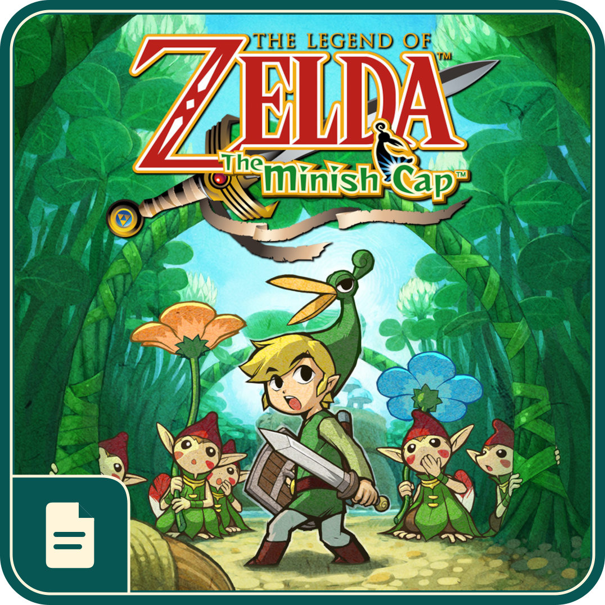

# Minish Cap Companion

An unofficial offline guide for **The Legend of Zelda: The Minish Cap**, made for the AYN Thor. The game runs on the top screen while this standalone Android reader can stay on the bottom screen through Cocoon's Companion App setting.

## Install

Download the signed APK from [Releases](https://github.com/gbppimentel-dev/minish-cap-companion/releases). Install over an existing Minish Cap Guide installation to retain reading progress. The existing package name is `dev.gbppimentel.guide.g8c0855a49adbd2d43a8c`; the app label remains **Minish Cap Guide**. Requires Android 8.0 or newer.

In Cocoon, select the Minish Cap ROM and assign Minish Cap Guide as its companion app. This guide does not include the game or emulator.

## Reader

Offline HTML guide, chapter links, saved reading position, touch scrolling and controller scrolling. Progress is stored in app-private preferences. No Internet permission is requested. The app does not read or alter game memory or saves.

## Build

Install JDK 21, Android SDK platform 36 and build-tools 36.0.0. Set `JAVA_HOME` and `ANDROID_HOME`, then run `python3 build.py` for an unsigned APK. To sign, supply `--keystore /path/to/your.keystore` and set `MINISH_KEYSTORE_PASSWORD` in the environment. The owner's signing key is private and is not included. A build signed with another key cannot update an existing installation signed by the owner.

## Current release

Version 1.0, build 8: original game art with a teal rounded border, ivory keyline and bottom-left document badge. The signed release APK updates installed build 7 with unchanged app code and guide content; only the icon resources and version code changed. Existing reading progress is retained by an in-place install. Previous build 7 is retained privately as a rollback backup.

The source reader was extracted from the owner's shared Walkthroughs project. See [third-party notices](THIRD_PARTY_NOTICES.md) for the separate rights to game artwork and walkthrough content.
